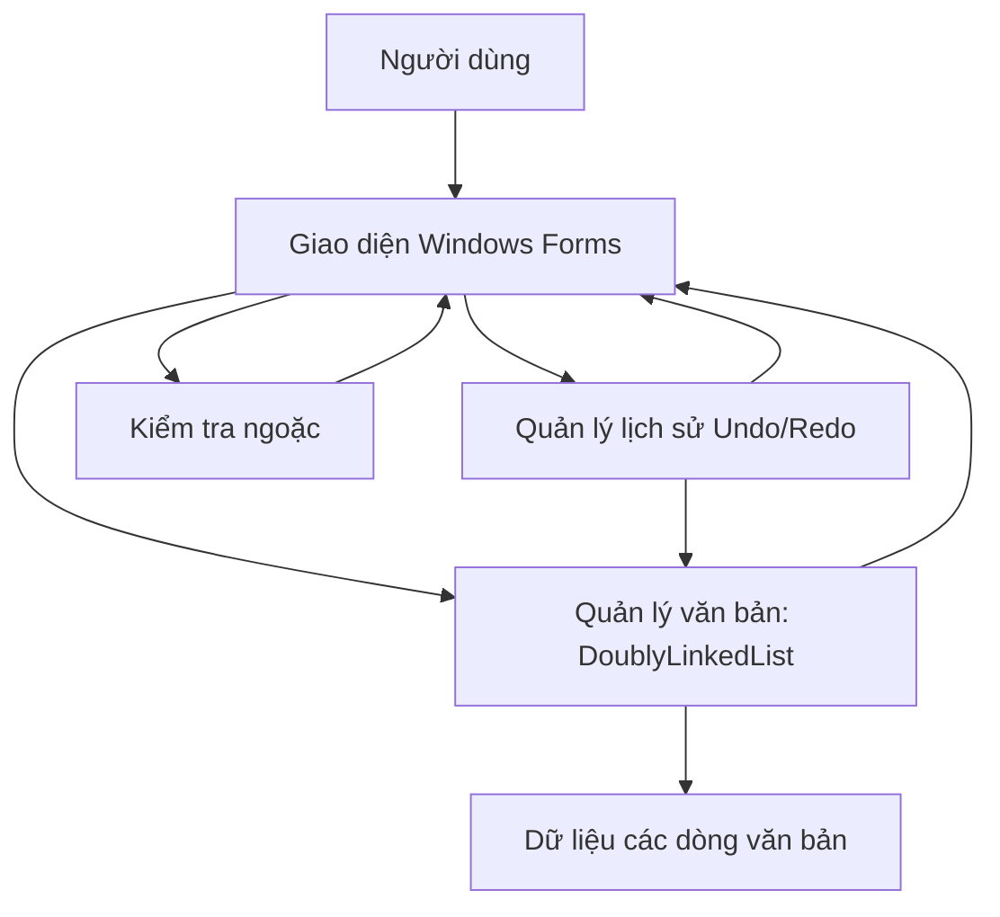

# CHƯƠNG 1. GIỚI THIỆU ĐỀ TÀI

## 1.1. Lý do lựa chọn đề tài

Trình soạn thảo văn bản là công cụ thường xuyên được sử dụng
trong học tập và lập trình. Trong quá trình chỉnh sửa, người dùng
có thể nhập sai, xóa nhầm hoặc thay đổi một đoạn nội dung.
Chức năng hoàn tác (Undo) và làm lại (Redo) giúp người dùng
khôi phục những thay đổi này.

Nhóm lựa chọn đề tài “Trình soạn thảo văn bản có Undo/Redo”
và đặt tên ứng dụng là CodeNote. Đề tài tạo điều kiện vận dụng
danh sách liên kết kép để quản lý các dòng văn bản, đồng thời
sử dụng ngăn xếp để quản lý lịch sử thao tác.

Đối với nội dung mã nguồn, kiểm tra tính cân bằng của các cặp
ngoặc là một tiện ích phù hợp. Chức năng này cũng là một
ứng dụng điển hình của cấu trúc ngăn xếp.

## 1.2. Mục tiêu

Các mục tiêu của dự án gồm:

- Quản lý các dòng văn bản bằng danh sách liên kết kép.
- Hỗ trợ chèn, xóa, tách dòng và gộp dòng.
- Hỗ trợ tìm kiếm và thay thế nội dung.
- Xây dựng cơ chế Undo/Redo bằng cấu trúc tự cài đặt.
- Giới hạn số bước hoàn tác được lưu trong lịch sử.
- Kiểm tra tính cân bằng của các cặp ngoặc (), [] và {}.
- Xây dựng giao diện Windows Forms bằng C++/CLI.
- Kiểm thử chức năng và đánh giá thời gian thực hiện.

Đây là các mục tiêu của đề tài. Mức độ hoàn thành từng mục
được xác định bằng mã nguồn và kết quả kiểm thử thực tế.

## 1.3. Phạm vi thực hiện

Ứng dụng tập trung vào soạn thảo văn bản và các đoạn mã nguồn.
Giao diện sử dụng Windows Forms C++/CLI, trong khi tầng lõi
quản lý văn bản được tổ chức riêng bằng C++.

Các cấu trúc dữ liệu chính được tự cài đặt bằng con trỏ.
Không sử dụng std::vector, std::list hoặc std::stack để thay
thế phần cấu trúc dữ liệu được yêu cầu. Chức năng Undo/Redo
cần được xây dựng riêng, không sử dụng Undo có sẵn của
Windows Forms thay cho thuật toán của nhóm.

Kiểm tra ngoặc chỉ xác định sự phù hợp của các cặp ngoặc
trong phạm vi mà chương trình hỗ trợ. Chức năng này không
thay thế trình biên dịch hoặc bộ kiểm tra toàn bộ cú pháp
của một ngôn ngữ lập trình.

## 1.4. Phương pháp thực hiện

Nhóm chia công việc thành các phần: thiết kế giao diện,
quản lý văn bản, quản lý lịch sử và kiểm thử.

Các thành phần được xây dựng độc lập trước khi tích hợp.
Phần kiểm thử chức năng sử dụng các ca có đầu vào, thao tác
và kết quả mong đợi rõ ràng.

Dữ liệu thực nghiệm gồm tệp mẫu 30 dòng và các tệp lớn
10.000, 20.000, 50.000 dòng. Thời gian xử lý được dự kiến
đo bằng std::chrono. Việc phân tích hiệu năng phải dựa trên
kết quả chạy thực tế trong điều kiện được ghi nhận.


# CHƯƠNG 2. CƠ SỞ LÝ THUYẾT

## 2.1. Danh sách liên kết kép

Danh sách liên kết kép gồm các nút được kết nối theo hai chiều.
Mỗi nút chứa dữ liệu, con trỏ đến nút trước và con trỏ đến
nút sau.

Trong CodeNote, một nút đại diện cho một dòng văn bản.
Cấu trúc Node trong mã nguồn gồm:

- lineData: nội dung dòng, sử dụng std::string.
- prev: con trỏ đến dòng trước.
- next: con trỏ đến dòng sau.

Lớp DoublyLinkedList quản lý head, tail và size, tương ứng
với nút đầu, nút cuối và số dòng hiện tại.

Ví dụ:

NULL ← [Dòng 1] ⇄ [Dòng 2] ⇄ [Dòng 3] → NULL

Danh sách cho phép duyệt theo cả hai chiều. Khi đã có
con trỏ tới vị trí cần xử lý, việc cập nhật các liên kết
để chèn hoặc xóa một nút có chi phí O(1).

Tuy nhiên, nếu đầu vào là chỉ số dòng, chương trình phải
tìm nút tương ứng. Trong mã nguồn của nhóm, getNodeAt
chọn duyệt từ head hoặc tail tùy vị trí. Cách này giảm
số nút cần duyệt nhưng độ phức tạp trường hợp xấu nhất
vẫn là O(n).

Ngoài chi phí liên kết, thao tác với nội dung dòng còn
có chi phí sao chép hoặc dịch chuyển ký tự trong chuỗi.
Vì vậy, không thể kết luận mọi thao tác chèn hoặc xóa
văn bản đều có độ phức tạp O(1).

## 2.2. Ngăn xếp

Ngăn xếp (Stack) hoạt động theo nguyên tắc LIFO:
phần tử được đưa vào sau cùng sẽ được lấy ra trước.

Các thao tác cơ bản:

- Push: đưa phần tử lên đỉnh.
- Pop: lấy phần tử ở đỉnh ra.
- Top: xem phần tử ở đỉnh.
- IsEmpty: kiểm tra ngăn xếp rỗng.

Với cách cài đặt bằng danh sách liên kết và quản lý
con trỏ đỉnh, Push và Pop có thể thực hiện trong O(1),
không tính chi phí sao chép dữ liệu của phần tử.

## 2.3. Nguyên lý Undo/Redo

Một cách tổ chức lịch sử là sử dụng hai ngăn xếp:
UndoStack và RedoStack.

Khi người dùng thực hiện thao tác mới:

1. Lưu thông tin cần thiết để hoàn tác thao tác.
2. Đưa bản ghi vào UndoStack.
3. Xóa lịch sử Redo cũ.

Khi thực hiện Undo:

1. Kiểm tra UndoStack có rỗng không.
2. Lấy thao tác gần nhất.
3. Thực hiện thao tác nghịch đảo.
4. Chuyển thông tin thao tác sang RedoStack.

Khi thực hiện Redo:

1. Kiểm tra RedoStack có rỗng không.
2. Lấy thao tác gần nhất đã hoàn tác.
3. Thực hiện lại thao tác.
4. Chuyển thông tin sang UndoStack.

Ví dụ, người dùng dán abc vào tài liệu trống bằng một
thao tác. Undo đưa tài liệu về trạng thái trống; Redo
đưa nội dung abc trở lại.

Thông tin trong bản ghi hành động phải đủ để phục hồi
văn bản, chẳng hạn loại hành động, vị trí và nội dung
đã chèn hoặc xóa.

Cách lưu bản ghi cụ thể sẽ được mô tả theo mã cài đặt
thực tế của thành viên phụ trách.

## 2.4. Giới hạn lịch sử hoàn tác

Giới hạn k bước nhằm kiểm soát số hành động được giữ lại.
Khi thêm hành động mới làm số bản ghi vượt quá k,
bản ghi cũ nhất cần được loại bỏ.

Một phương án là dùng danh sách liên kết kép để quản lý
hai đầu: một đầu phục vụ thao tác mới nhất, đầu còn lại
phục vụ loại bỏ thao tác cũ nhất.

Giới hạn số bản ghi không đồng nghĩa với giới hạn chính xác
số byte bộ nhớ, vì mỗi bản ghi có thể chứa lượng văn bản
khác nhau.

## 2.5. Kiểm tra ngoặc bằng ngăn xếp

Thuật toán cơ bản duyệt lần lượt các ký tự:

1. Gặp ngoặc mở thì đưa vào Stack.
2. Gặp ngoặc đóng thì kiểm tra Stack.
3. Nếu Stack rỗng hoặc đỉnh không cùng loại, kết luận sai.
4. Nếu cùng loại, lấy ngoặc mở khỏi Stack.
5. Kết thúc duyệt, chỉ chấp nhận nếu Stack rỗng.

Ví dụ:

- ([]{}) là cân bằng.
- ([)] không cân bằng vì sai thứ tự đóng ngoặc.
- (() không cân bằng vì thiếu ngoặc đóng.

Với N ký tự, thuật toán cơ bản có thời gian O(N)
và bộ nhớ phụ O(N) trong trường hợp xấu nhất.

Khi áp dụng cho mã nguồn, cần xác định rõ cách xử lý
ngoặc trong chuỗi ký tự và chú thích. Không mặc nhiên
coi thuật toán cơ bản là bộ phân tích cú pháp hoàn chỉnh.

## 2.6. Đo thời gian bằng std::chrono

std::chrono cung cấp các công cụ đo khoảng thời gian.
Có thể dùng steady_clock để lấy thời điểm trước và sau
một lời gọi hàm, sau đó tính hiệu hai thời điểm.

Để phép đo có ý nghĩa:

- Ghi rõ dữ liệu, môi trường và cờ biên dịch.
- Chạy nhiều lần và giữ lại kết quả từng lần.
- Chuẩn bị dữ liệu ngoài khoảng đo nếu không đo bước đó.
- Kiểm tra kết quả để bảo đảm hàm thực hiện đúng.
- Khôi phục dữ liệu đầu vào giữa các lần đo có thay đổi dữ liệu.
- Phân biệt thời gian thuật toán với thời gian giao diện.
- Ghi nhận ảnh hưởng của bộ nhớ đệm đối với đọc tệp.

Không suy ra độ phức tạp chỉ từ một lần chạy. Cần kết hợp
phân tích mã nguồn với xu hướng số liệu thực nghiệm.


# CHƯƠNG 3. PHÂN TÍCH VÀ THIẾT KẾ

## 3.1. Phân tích yêu cầu chức năng

Theo kế hoạch của nhóm, CodeNote hướng đến các chức năng sau:

| Nhóm chức năng | Yêu cầu |
|---|---|
| Quản lý tệp | Mở nội dung từ tệp và lưu nội dung ra tệp |
| Chỉnh sửa | Chèn, xóa ký tự; thêm, xóa, tách và gộp dòng |
| Tìm kiếm | Tìm lần xuất hiện đầu tiên, tiếp theo và tất cả vị trí |
| Thay thế | Thay nội dung tại vị trí cụ thể hoặc thay thế tất cả |
| Lịch sử | Hoàn tác, làm lại và giới hạn số thao tác được lưu |
| Kiểm tra ngoặc | Phát hiện ngoặc thiếu, thừa hoặc đóng sai thứ tự |
| Thống kê | Thống kê số dòng, số từ và số ký tự |
| Trực quan hóa | Minh họa cấu trúc danh sách và lịch sử thao tác |

Bảng trên mô tả yêu cầu thiết kế. Kết quả hoàn thành của từng
chức năng phải được xác nhận bằng quá trình tích hợp và kiểm thử.

## 3.2. Kiến trúc chương trình

Chương trình được định hướng tách thành tầng giao diện
và tầng lõi.

### 3.2.1. Tầng giao diện

Giao diện sử dụng Windows Forms C++/CLI, có nhiệm vụ:

- Hiển thị và tiếp nhận nội dung người dùng nhập.
- Nhận sự kiện từ menu, nút bấm và phím tắt.
- Chuyển yêu cầu xử lý xuống tầng lõi.
- Hiển thị kết quả và trạng thái thao tác.
- Vẽ phần trực quan hóa theo dữ liệu của tầng lõi.

### 3.2.2. Tầng lõi

Tầng lõi chịu trách nhiệm quản lý dữ liệu và thực hiện thuật toán.

Trong mã nguồn đã được xem xét, lớp DoublyLinkedList
được cài đặt bằng C++ thuần trong hai tệp:

- DoublyLinkedList.h
- DoublyLinkedList.cpp

Các thành phần lịch sử và kiểm tra ngoặc sẽ được mô tả
chi tiết sau khi đối chiếu mã nguồn của thành viên phụ trách.

Sơ đồ dưới đây thể hiện kiến trúc dự kiến, không dùng để
khẳng định mọi kết nối đã được tích hợp:



Việc tách tầng giúp kiểm thử các hàm quản lý văn bản
độc lập với giao diện. Điều này cũng hỗ trợ đo thời gian
xử lý mà không gộp thêm chi phí vẽ giao diện.

## 3.3. Thiết kế dữ liệu quản lý văn bản

### 3.3.1. Cấu trúc Node

Mỗi Node đại diện cho một dòng văn bản:

```cpp
struct Node {
    std::string lineData;
    Node* prev;
    Node* next;
};
```

Trong đó:

- lineData lưu nội dung của dòng.
- prev trỏ đến dòng trước, hoặc nullptr nếu là dòng đầu.
- next trỏ đến dòng sau, hoặc nullptr nếu là dòng cuối.

Ví dụ:

```text
head                                    tail
 ↓                                       ↓
[Dòng 1] ⇄ [Dòng 2] ⇄ [Dòng 3] ⇄ [Dòng 4]
```

### 3.3.2. Lớp DoublyLinkedList

Lớp quản lý ba thuộc tính chính:

| Thuộc tính | Vai trò |
|---|---|
| head | Trỏ đến nút đầu danh sách |
| tail | Trỏ đến nút cuối danh sách |
| size | Lưu số dòng hiện tại |

Các điều kiện cần duy trì:

- Khi danh sách rỗng, head và tail bằng nullptr, size bằng 0.
- Khi không rỗng, head->prev và tail->next bằng nullptr.
- Với hai nút liên tiếp, liên kết next và prev phải tương ứng.
- Số nút khi duyệt phải bằng size.

Lớp có hàm hủy, hàm tạo sao chép và toán tử gán sao chép.
Việc sao chép tạo các nút riêng để tránh hai danh sách
cùng sở hữu một vùng nhớ.

Đây là đặc điểm của thiết kế và mã cài đặt; việc xác nhận
không rò rỉ bộ nhớ vẫn cần kiểm tra thực tế.

### 3.3.3. Vị trí trong văn bản

Cấu trúc TextPosition lưu:

- line: chỉ số dòng.
- col: chỉ số cột.

Chỉ số bắt đầu từ 0. Ví dụ, vị trí dòng đầu và cột đầu
được biểu diễn bằng (0, 0).

Các hàm thao tác trên std::string sử dụng chỉ số phần tử
của chuỗi. Với dữ liệu UTF-8, chỉ số byte không nhất thiết
trùng với số ký tự người dùng nhìn thấy. Vì vậy, việc ánh xạ
vị trí giữa giao diện và tầng lõi cần được kiểm thử riêng
với văn bản tiếng Việt.

### 3.3.4. Kết quả tìm kiếm

Mỗi SearchResult lưu:

- line: dòng chứa kết quả.
- col: vị trí bắt đầu kết quả.
- length: độ dài đoạn khớp.
- next: kết quả tiếp theo.

Hàm findAll trả về danh sách liên kết đơn các kết quả.
Sau khi sử dụng, bên gọi cần giải phóng danh sách bằng
freeSearchResults để tránh giữ lại bộ nhớ đã cấp phát.

## 3.4. Thiết kế các nhóm thao tác

Các hàm được khai báo trong mã nguồn DoublyLinkedList gồm:

| Nhóm thao tác | Hàm tiêu biểu |
|---|---|
| Truy xuất | getSize, getNodeAt, getLine, setLine |
| Quản lý dòng | appendLine, prependLine, insertLine, deleteLine |
| Tách và gộp | splitLine, mergeLines |
| Chỉnh sửa ký tự | insertChar, deleteChar, backspaceChar |
| Chỉnh sửa đoạn | insertTextAt, deleteRange |
| Sao chép, cắt, dán | copyRange, cutRange, pasteText |
| Tìm kiếm | customStringFind, findFirst, findNext, findAll |
| Thay thế | replaceAt, replaceAll |
| Thống kê | getStatistics, getWordCount, getLineCount, getCharCount |
| Đọc và ghi | loadFromFile, saveToFile, loadFromText, getAllText |
| Trực quan hóa | getNodeVisualInfo |

Việc có hàm trong tầng lõi chưa đồng nghĩa nút hoặc menu
tương ứng trên giao diện đã kết nối và hoạt động đúng.

## 3.5. Thiết kế lịch sử thao tác

Theo kế hoạch, một bản ghi hành động cần chứa đủ thông tin
để thực hiện lại và đảo ngược thao tác.

Thông tin có thể gồm:

- Loại thao tác.
- Vị trí bắt đầu.
- Nội dung bị xóa.
- Nội dung được chèn.

UndoStack lưu các thao tác có thể hoàn tác.
RedoStack lưu các thao tác đã hoàn tác và có thể làm lại.

Trong lúc áp dụng Undo hoặc Redo, chương trình cần tránh
ghi chính thao tác phục hồi thành một thao tác chỉnh sửa mới.

Cấu trúc bản ghi, tên lớp và cách điều phối cụ thể cần
được cập nhật theo mã thực tế của TV3.

## 3.6. Thiết kế kiểm thử

Kiểm thử được chia thành hai nhóm:

### Kiểm thử chức năng

Dùng các trường hợp nhỏ với kết quả mong đợi rõ ràng:
chèn, xóa, xuống dòng, tìm kiếm, thay thế, Undo/Redo,
giới hạn lịch sử và kiểm tra ngoặc.

Danh sách ca kiểm thử được lưu tại:

TV4/KiemThu/KeHoachKiemThu.md

### Thực nghiệm hiệu năng

Dùng dữ liệu 10.000, 20.000 và 50.000 dòng để khảo sát
thời gian của các hàm xử lý.

Mỗi phép đo cần kiểm tra kết quả đầu ra, xác định phần công việc
được tính thời gian và giữ điều kiện chạy nhất quán.

Phần thực nghiệm chưa hoàn thành sẽ được ghi rõ ở Chương 5;
không dùng kết quả mong đợi thay cho số liệu thực tế.

# CHƯƠNG 4. CÀI ĐẶT VÀ PHÂN TÍCH THUẬT TOÁN

## 4.1. Tổ chức mã nguồn

Phần quản lý văn bản được tổ chức trong hai tệp:

- DoublyLinkedList.h: khai báo các cấu trúc và giao diện hàm.
- DoublyLinkedList.cpp: cài đặt các thao tác xử lý.

Các cấu trúc được sử dụng gồm Node, TextPosition,
SearchResult, TextStatistics và lớp DoublyLinkedList.

Các thao tác được chia thành nhóm: quản lý bộ nhớ,
quản lý dòng, chỉnh sửa văn bản, tìm kiếm, thay thế,
thống kê, đọc/ghi tệp và hỗ trợ trực quan hóa.

Quy ước phân tích:

- n: số dòng.
- N: tổng số byte nội dung.
- L: độ dài một dòng.
- m: độ dài từ khóa.
- r: số kết quả tìm kiếm.

Các chỉ số chuỗi được tính theo std::string.
Với UTF-8, số byte không nhất thiết bằng số ký tự hiển thị.

## 4.2. Khởi tạo, sao chép và giải phóng bộ nhớ

Hàm tạo khởi tạo danh sách rỗng:
head và tail bằng nullptr, size bằng 0.

Hàm clear duyệt lần lượt các nút. Trước khi xóa nút hiện tại,
chương trình lưu địa chỉ nút tiếp theo để tiếp tục duyệt.
Kết thúc, các con trỏ đầu/cuối và số lượng nút được đặt lại.

Hàm hủy gọi clear để giải phóng các nút thuộc danh sách.

Lớp có hàm tạo sao chép và toán tử gán sao chép.
Các nút mới được tạo từ nội dung danh sách nguồn,
thay vì chỉ sao chép con trỏ.

Toán tử gán kiểm tra trường hợp tự gán trước khi xóa dữ liệu cũ.
Sao chép sâu giúp hai đối tượng quản lý các nút riêng biệt.

Việc có các hàm giải phóng chưa đủ để kết luận không rò rỉ
bộ nhớ trong mọi tình huống; vẫn cần kiểm tra thực tế.

## 4.3. Truy xuất dòng bằng getNodeAt

Hàm getNodeAt nhận chỉ số dòng bắt đầu từ 0.

Nếu chỉ số không hợp lệ, hàm trả về nullptr.
Nếu hợp lệ, chương trình chọn hướng duyệt:

- Nửa đầu danh sách: duyệt từ head theo next.
- Nửa sau danh sách: duyệt từ tail theo prev.

Truy xuất nút đầu hoặc cuối có chi phí O(1).
Trường hợp xấu nhất gần giữa danh sách có chi phí O(n).

Cách chọn đầu gần hơn giảm số bước duyệt nhưng không
làm truy xuất theo chỉ số trở thành O(1).

## 4.4. Thêm và xóa dòng

### 4.4.1. Thêm đầu và cuối

appendLine tạo nút mới, nối sau tail, cập nhật tail và tăng size.
prependLine thực hiện tương tự ở đầu danh sách.

Nếu danh sách rỗng, head và tail cùng trỏ đến nút mới.

Phần cập nhật liên kết có chi phí O(1).
Việc sao chép nội dung dòng mới có thêm chi phí O(L).

### 4.4.2. Chèn theo chỉ số

insertLine chia thành ba trường hợp:

- Chỉ số nhỏ hơn hoặc bằng 0: thêm đầu.
- Chỉ số lớn hơn hoặc bằng size: thêm cuối.
- Vị trí ở giữa: tìm nút rồi chèn trước nút đó.

Khi chèn giữa, chương trình cập nhật cả prev và next.
Trường hợp xấu nhất có chi phí O(n + L), gồm tìm vị trí
và sao chép nội dung.

### 4.4.3. Xóa dòng

deleteLine tìm nút và phân biệt các trường hợp:
nút duy nhất, nút đầu, nút cuối hoặc nút giữa.

Sau khi nối lại các nút còn lại, chương trình giải phóng nút
và giảm size. Chỉ số không hợp lệ không làm thay đổi danh sách.

Chi phí tìm vị trí là O(n) trong trường hợp xấu nhất.
Phần cập nhật liên kết khi đã có nút là O(1).

## 4.5. Tách dòng và gộp dòng

### 4.5.1. Tách bằng splitLine

Hàm tìm dòng, điều chỉnh vị trí cột về phạm vi hợp lệ
và chia chuỗi thành hai phần.

Phần trước vị trí tách được giữ lại trong nút hiện tại.
Phần sau được đưa vào nút mới nối ngay phía sau.
Nếu cần, tail được cập nhật; size tăng một.

Ví dụ, tách abcdef tại cột 3 tạo hai dòng abc và def.

Tổng chi phí trường hợp xấu nhất là O(n + L).
Chỉ riêng việc nối nút mới có chi phí O(1).

### 4.5.2. Gộp bằng mergeLines

Hàm nối nội dung dòng được chỉ định vào cuối dòng trước.
Sau đó loại nút của dòng hiện tại, cập nhật các liên kết,
giải phóng nút và giảm size.

Dòng đầu và chỉ số ngoài phạm vi không được gộp.

Với hai dòng có độ dài L1 và L2, cận trên thông thường
là O(n + L1 + L2), gồm tìm vị trí và xử lý chuỗi.

## 4.6. Chỉnh sửa ký tự và đoạn văn bản

insertChar tìm dòng bằng getNodeAt rồi chèn ký tự bằng
std::string::insert. Nếu danh sách rỗng, hàm tạo dòng mới
chứa ký tự đó.

Khi chèn trong chuỗi, các ký tự phía sau có thể phải dịch chuyển.
Chi phí trường hợp xấu nhất là O(n + L).

Các hàm deleteChar và backspaceChar hỗ trợ xóa ký tự.
Khi kiểm thử, cần phân biệt xóa trong dòng với thao tác
ở cuối dòng hoặc đầu dòng có thể dẫn tới gộp dòng.

Các hàm insertTextAt và deleteRange xử lý đoạn văn bản.
copyRange, cutRange và pasteText cung cấp thao tác sao chép,
cắt và dán ở tầng lõi.

Việc giao diện có gọi đúng các hàm này hay không phải
được kiểm tra riêng khi tích hợp.

## 4.7. Thuật toán tìm kiếm

### 4.7.1. customStringFind

Hàm dùng phương pháp so khớp trực tiếp:

1. Xét từng vị trí bắt đầu có thể của từ khóa.
2. So sánh lần lượt các phần tử.
3. Nếu khác nhau, chuyển sang vị trí bắt đầu tiếp theo.
4. Trả về vị trí đầu tiên khớp hoàn toàn.
5. Trả về -1 nếu không tìm thấy.

Với dòng dài L và từ khóa dài m,
cận trên trường hợp xấu nhất là O(L × m).

Chế độ không phân biệt hoa/thường sử dụng std::tolower
trên các byte. Đây không phải cơ chế chuyển đổi
hoa/thường Unicode đầy đủ.

### 4.7.2. findFirst

Hàm duyệt các dòng từ head, gọi customStringFind trên mỗi dòng
và dừng khi có kết quả.

Nếu tìm thấy, hàm trả về true và ghi lại dòng, cột.
Nếu không tìm thấy, hàm trả về false.
Từ khóa rỗng bị từ chối.

Cận trên cho toàn văn bản là O(n + N × m).
Thời gian thực tế phụ thuộc vị trí kết quả đầu tiên.

### 4.7.3. findAll

Hàm tìm trên từng dòng và cấp phát một SearchResult
cho mỗi lần xuất hiện.

Sau khi khớp, vị trí tìm tiếp tăng bằng độ dài từ khóa.
Vì vậy, kết quả không chồng lấn.

Ví dụ, tìm aa trong aaa chỉ trả về một kết quả tại cột 0.

Bộ nhớ phụ cho r kết quả là O(r).
Bên gọi cần giải phóng danh sách bằng freeSearchResults.

## 4.8. Thuật toán thay thế

replaceAt thay một đoạn tại vị trí cụ thể.
replaceAll duyệt từng dòng, tìm các đoạn khớp rồi thay
bằng nội dung mới.

Sau mỗi lần thay, vị trí tìm tiếp được đặt sau đoạn
vừa chèn. Hàm trả về tổng số lần thay thế.

Chi phí phụ thuộc:

- Độ dài và nội dung từ khóa.
- Số lần xuất hiện.
- Độ dài chuỗi thay thế.
- Số ký tự cần dịch chuyển.

Không mặc định mọi trường hợp replaceAll đều có thời gian O(N).

Trong thực nghiệm, mỗi lượt thay thế sử dụng bản sao
của dữ liệu gốc để các lượt có đầu vào tương đương.

## 4.9. Đọc, ghi và trao đổi văn bản

loadFromFile mở tệp bằng std::ifstream.
Nếu không mở được, hàm trả về false.

Sau khi mở, hàm xóa danh sách cũ, đọc từng dòng bằng
std::getline và thêm dòng bằng appendLine.
Ký tự carriage return ở cuối dòng được loại bỏ nếu có.
Tệp không có dòng nào được biểu diễn bằng một dòng rỗng.

saveToFile duyệt danh sách và ghi nội dung từng dòng,
chèn ký tự xuống dòng giữa các dòng.

Phiên bản được xem xét kiểm tra khả năng mở tệp,
nhưng chưa kiểm tra đầy đủ trạng thái luồng sau đọc/ghi.
Đây là điểm cần bổ sung khi xử lý lỗi I/O.

getAllText nối các dòng bằng CRLF để cung cấp nội dung
cho giao diện. loadFromText xây dựng lại danh sách
từ chuỗi được truyền vào.

Nếu giao diện xây dựng lại toàn bộ danh sách sau mỗi
thay đổi nhỏ, cần đánh giá chi phí trên văn bản lớn.

## 4.10. Thống kê và hỗ trợ trực quan hóa

TextStatistics lưu số dòng, số từ, số ký tự
và số ký tự không tính khoảng trắng.

Các hàm thống kê cung cấp thông tin cho giao diện.
Cách đếm cần được kiểm thử với dòng trống, nhiều khoảng trắng
và nội dung tiếng Việt.

getNodeVisualInfo cung cấp nội dung cùng địa chỉ nút hiện tại,
nút trước và nút sau để hỗ trợ vẽ cấu trúc liên kết.

Địa chỉ chỉ có ý nghĩa trong lần chạy hiện tại,
không dùng làm giá trị cố định giữa các máy.

## 4.11. Phạm vi cài đặt đã đối chiếu

Phần phân tích trên dựa vào mã DoublyLinkedList của nhóm.

Mã cụ thể của ActionStack, bộ điều phối Undo/Redo,
giới hạn k bước và kiểm tra ngoặc chưa được cung cấp
để đối chiếu trong bản phân tích này.

Các phần đó cần được cập nhật theo mã thực tế,
không dùng mô tả nguyên lý thay cho bằng chứng cài đặt.

Kết quả biên dịch và thực nghiệm phần lõi không thay thế
việc kiểm thử các chức năng tích hợp trên giao diện.
## 4.12. Giao diện và quá trình khởi chạy

### Giao diện Windows Forms

Giao diện được thiết kế trong CodeNote_N3.h.
Tệp CodeNote_N3.resx lưu tài nguyên liên quan đến Form.

Các thành phần giao diện đã được quan sát gồm:

- Vùng soạn thảo RichTextBox.
- Menu Tệp, Chỉnh sửa, Công cụ và Trợ giúp.
- Thanh công cụ mở, lưu, hoàn tác và làm lại.
- Khu vực tìm kiếm và thay thế.
- Khu vực thống kê văn bản.
- Khu vực hiển thị kết quả kiểm tra ngoặc.
- Điều khiển giới hạn số bước Undo/Redo.
- Các nhãn thông tin dòng, cột và trạng thái.

Việc có nút hoặc nhãn trên giao diện chưa chứng minh chức năng
đã kết nối với tầng lõi. Trong phiên bản mã đã kiểm tra,
chưa thấy phần xử lý sự kiện gọi các thuật toán tương ứng.

Các dòng thông báo đặt sẵn, chẳng hạn “Ngoặc cân bằng!”,
không được sử dụng làm kết quả kiểm thử.

### Quá trình khởi chạy

CodeNote_N3.cpp chứa hàm main của ứng dụng.

Chương trình bật kiểu hiển thị Windows Forms, thiết lập
cách hiển thị văn bản và gọi Application::Run để khởi tạo
cửa sổ CodeNote_N3.

Cấu hình dự án được quản lý trong N3_CTDLGT.vcxproj.
Phiên bản được xem xét sử dụng C++/CLI và .NET Framework 4.7.2.
Dự án đã liệt kê mã nguồn DoublyLinkedList trong danh sách
các tệp cần biên dịch.

Việc đưa mã lõi vào dự án chưa đồng nghĩa mọi sự kiện giao diện
đã được kết nối với các hàm xử lý.

### Môi trường chạy

Ứng dụng Windows Forms C++/CLI cần môi trường Windows phù hợp.

Phần DoublyLinkedList là C++ thuần và đã được biên dịch
độc lập trên Mac. Kết quả này không thay thế việc chạy
kiểm thử toàn bộ giao diện trên Windows.


# CHƯƠNG 5. KIỂM THỬ VÀ THỰC NGHIỆM

## 5.1. Mục tiêu kiểm thử

Quá trình kiểm thử nhằm:

- Xác định các thao tác chỉnh sửa có cho kết quả đúng không.
- Kiểm tra tính đúng đắn của tìm kiếm và thay thế.
- Kiểm tra Undo/Redo và giới hạn lịch sử khi được tích hợp.
- Kiểm tra thuật toán ngoặc với trường hợp đúng và sai.
- Đánh giá thời gian xử lý trên nhiều kích thước dữ liệu.

Kết quả mong đợi và kết quả chạy thực tế được ghi riêng.
Các chức năng chưa chạy không được đánh dấu Đạt.

## 5.2. Chuẩn bị dữ liệu

Dữ liệu được lưu trong TV4/DuLieuTest.

| Tệp | Số dòng | Mục đích |
|---|---:|---|
| mau_30_dong.cpp | 30 | Kiểm thử thủ công với dữ liệu nhỏ |
| mau_10000_dong.cpp | 10.000 | Thực nghiệm dữ liệu lớn |
| mau_20000_dong.cpp | 20.000 | Khảo sát khi tăng số dòng |
| mau_50000_dong.cpp | 50.000 | Khảo sát kích thước lớn hơn |

Ba tệp lớn được tạo bằng chương trình sinh_du_lieu.cpp.

Dòng thứ i có nội dung dạng:

void ham_i() { int a[3] = {1, 2, 3}; }

Tên hàm thay đổi theo số thứ tự, còn cấu trúc dòng gần giống nhau.
Mỗi dòng có đủ ba loại ngoặc và các ngoặc cân bằng.

Lệnh wc -l đã được sử dụng để xác nhận ba tệp lớn lần lượt
có 10.000, 20.000 và 50.000 dòng, tổng cộng 80.000 dòng.

Dữ liệu này thuận tiện để kiểm tra số kết quả:
mỗi dòng có một lần xuất hiện của từ khóa int.

Đây là dữ liệu tổng hợp, chưa đại diện đầy đủ cho mọi loại
mã nguồn thực tế, đặc biệt là dòng rất dài, Unicode,
chuỗi ký tự và chú thích phức tạp.

## 5.3. Kiểm thử chức năng

### 5.3.1. Kế hoạch kiểm thử toàn ứng dụng

Các ca kiểm thử của toàn ứng dụng được lưu tại:

TV4/KiemThu/KeHoachKiemThu.md

Các ca này bao gồm giao diện, chỉnh sửa, Undo/Redo,
giới hạn lịch sử, tìm kiếm, thay thế và kiểm tra ngoặc.

Chưa có bộ kết quả chạy đầy đủ trên giao diện Windows.
Không dùng kết quả kiểm thử phần lõi để đánh dấu toàn bộ
các ca kiểm thử tích hợp là đã đạt.

### 5.3.2. Kết quả kiểm thử tự động phần lõi

Chương trình KiemThuCore.cpp gọi trực tiếp các hàm
của DoublyLinkedList, độc lập với Windows Forms.

Bộ kiểm thử đã chạy trên Mac bằng clang++ với C++17,
cờ -O2, -Wall và -Wextra.

| Mã | Nội dung kiểm thử | Kết quả thực tế |
|---|---|---|
| C01 | Thêm, chèn, xóa dòng và kiểm tra liên kết hai chiều | PASS |
| C02 | Tách dòng rồi gộp lại | PASS |
| C03 | Chèn ký tự, Delete và Backspace trong dòng | PASS |
| C04 | Chèn đoạn nhiều dòng rồi xóa đoạn đó | PASS |
| C05 | Sao chép và gán danh sách; thay đổi một bản không làm đổi bản khác | PASS |
| C06 | Tìm kiếm phân biệt và không phân biệt hoa/thường với ASCII | PASS |
| C07 | Tìm tất cả các kết quả không chồng lấn | PASS |
| C08 | Thay thế tất cả và xử lý từ khóa không xuất hiện | PASS |
| C09 | Delete cuối dòng, Backspace đầu dòng và xóa nút duy nhất | PASS |
| C10 | Lưu rồi mở lại văn bản UTF-8 nhiều dòng | PASS |

Tổng số: 10 ca.
Đạt: 10 ca.
Không đạt: 0 ca.

Kết quả được ghi tại:

TV4/KetQua/ket_qua_kiem_thu_core.csv

### 5.3.3. Phạm vi kết luận

Kết quả xác nhận các tình huống C01–C10 cho đầu ra
đúng với mong đợi trong lần chạy được ghi nhận.

Bộ kiểm thử chưa bao gồm:

- Giao diện Windows Forms.
- Undo/Redo và giới hạn lịch sử.
- Kiểm tra ngoặc.
- Toàn bộ tình huống biên và lỗi đọc/ghi tệp.
- Kiểm tra rò rỉ bộ nhớ bằng công cụ chuyên dụng.

C10 xác nhận việc giữ nội dung UTF-8 khi lưu/mở lại.
Ca này không chứng minh các thao tác vị trí con trỏ
hoặc chuyển đổi hoa/thường Unicode đều đúng.
## 5.4. Các bước chuẩn bị đã xác nhận

| Nội dung | Bằng chứng | Kết luận trong phạm vi kiểm tra |
|---|---|---|
| Sinh ba tệp dữ liệu lớn | Thông báo chương trình sinh dữ liệu | Đã tạo được các tệp |
| Kiểm tra số dòng | Kết quả wc -l trên Terminal | Đúng số dòng của ba tệp lớn |
| Biên dịch độc lập DoublyLinkedList | Lệnh clang++ trên Mac không báo lỗi | Phần lõi biên dịch được trong môi trường đó |
| Chạy giao diện và các chức năng | Chưa có bộ kết quả kiểm thử | Chưa kết luận |
| Đo thời gian bốn thao tác lõi | Hai CSV gồm 120 lượt đo và 12 giá trị trung bình | Đã có kết quả; phân tích tại mục 5.7 và 5.8 |
Biên dịch thành công không chứng minh thuật toán đúng
trong mọi trường hợp hoặc không có rò rỉ bộ nhớ.

## 5.5. Thiết kế phép đo thời gian

Chương trình DoThoiGian.cpp được chuẩn bị để gọi trực tiếp
các hàm của DoublyLinkedList.

Bốn phép đo gồm:

| Phép đo | Công việc | Kết quả cần kiểm tra |
|---|---|---|
| loadFromFile | Nạp tệp vào danh sách mới | Đúng số dòng và nội dung |
| findFirst_missing | Tìm từ khóa không tồn tại | Trả về không tìm thấy |
| findAll_int | Tìm tất cả int | Có đúng một kết quả trên mỗi dòng |
| replaceAll_int_long | Thay int bằng long | Đúng số lần thay và nội dung sau thay |

Phép đo sử dụng std::chrono::steady_clock.
Đơn vị kết quả là micro giây, ký hiệu µs.

Với mỗi kích thước, thực hiện một lượt làm nóng,
sau đó ghi nhận 10 lượt chạy.

Kiểm tra kết quả và ghi CSV nằm ngoài khoảng đo.
Việc sao chép dữ liệu trước replaceAll cũng nằm ngoài
khoảng đo, giúp mỗi lần thay thế bắt đầu từ dữ liệu gốc.

Phép đo findAll có tính thời gian tạo các nút kết quả,
nhưng không tính thời gian giải phóng danh sách kết quả.

Phép đo loadFromFile có thể chịu ảnh hưởng bộ nhớ đệm.
Không gọi đây là phép đo tốc độ đọc đĩa thuần túy.

## 5.6. Môi trường thực nghiệm

Thông tin đã quan sát:

- Kiến trúc trình biên dịch: arm64.
- Trình biên dịch trên máy thực hiện: Apple clang 21.0.0.
- Chuẩn biên dịch dự kiến: C++17.
- Cờ tối ưu dự kiến cho chương trình đo: -O2.

Cần bổ sung trước khi công bố kết quả:

- Tên CPU và dung lượng RAM.
- Phiên bản macOS.
- Phiên bản mã nguồn được đo.
- Xác nhận lệnh biên dịch và chạy thực tế.

Số liệu thu trên Mac chỉ phản ánh phần lõi trong môi trường đó,
không phải thời gian đáp ứng toàn bộ giao diện Windows.

## 5.7. Kết quả thực nghiệm

Hai tệp kết quả được lưu tại TV4/KetQua:

- ket_qua_chi_tiet.csv.
- ket_qua_trung_binh.csv.

Dữ liệu gồm 120 lượt đo: bốn phép đo, ba kích thước
và 10 lần ghi nhận cho mỗi tổ hợp.

Đã đối chiếu lại trung bình từ các lượt đo chi tiết.
Các giá trị khớp với tệp tổng hợp sau khi làm tròn
đến ba chữ số thập phân.

### Bảng thời gian trung bình

Đơn vị: micro giây (µs). Một mili giây bằng 1.000 µs.

| Phép đo | 10.000 dòng | 20.000 dòng | 50.000 dòng |
|---|---:|---:|---:|
| Nạp tệp — loadFromFile | 591.712 | 797.412 | 1903.350 |
| Tìm từ không tồn tại — findFirst | 247.533 | 375.721 | 1020.213 |
| Tìm tất cả int — findAll | 555.654 | 827.029 | 1960.696 |
| Thay int bằng long — replaceAll | 631.258 | 849.704 | 2040.383 |

Dấu chấm trong bảng là dấu thập phân, theo định dạng CSV.
Ví dụ, 1903.350 µs tương đương khoảng 1.903 ms.

## 5.8. Phân tích kết quả

### Xu hướng theo kích thước

Trong cả bốn phép đo, thời gian trung bình tăng khi dữ liệu
tăng từ 10.000 lên 20.000 và 50.000 dòng.

Khi số dòng tăng từ 20.000 lên 50.000, tức 2,5 lần,
thời gian tăng lần lượt:

- Nạp tệp: khoảng 2,39 lần.
- Tìm từ không tồn tại: khoảng 2,72 lần.
- Tìm tất cả int: khoảng 2,37 lần.
- Thay int bằng long: khoảng 2,40 lần.

Với dữ liệu có độ dài dòng gần tương đương và từ khóa
cố định, xu hướng này phù hợp với việc các hàm phải xử lý
lượng nội dung lớn hơn.

Kết quả trên không chứng minh mọi trường hợp đều có
độ phức tạp tuyến tính. Độ dài từ khóa, nội dung dòng
và số kết quả vẫn ảnh hưởng đến chi phí xử lý.

### Nhận xét từng phép đo

findFirst được đo với từ khóa không tồn tại nên cần duyệt
qua toàn bộ văn bản để kết luận không tìm thấy.
Đây không phải thời gian tìm từ xuất hiện ngay đầu tệp.

findAll vừa so khớp vừa cấp phát các nút SearchResult.
Trong dữ liệu sử dụng, mỗi dòng có một từ int nên số
kết quả bằng số dòng.

replaceAll thực hiện tìm kiếm và thay đổi chuỗi.
Mỗi lượt bắt đầu từ bản sao dữ liệu gốc; thời gian tạo
bản sao không nằm trong khoảng đo.

loadFromFile gồm đọc nội dung và xây dựng danh sách.
Kết quả có thể chịu ảnh hưởng bộ nhớ đệm của hệ điều hành,
không được xem là tốc độ đọc đĩa thuần túy.

### Mức dao động

Nhóm 10.000 dòng có dao động đáng kể giữa các lượt.
Ví dụ, thời gian nạp tệp nằm trong khoảng 365.709 đến
1184.333 µs, trong khi trung bình là 591.712 µs.

Vì vậy, không kỳ vọng thời gian tăng chính xác theo
tỷ lệ số dòng. Các lượt đo được giữ nguyên, không loại bỏ
chỉ vì có giá trị cao hơn các lượt còn lại.

### Phạm vi kết luận

Bộ số liệu đánh giá bốn thao tác của phần lõi DoublyLinkedList
trên dữ liệu tổng hợp trong môi trường máy thực hiện.

Kết quả không thay thế kiểm thử giao diện, Undo/Redo,
kiểm tra ngoặc hoặc kiểm tra rò rỉ bộ nhớ.


# CHƯƠNG 6. KẾT LUẬN VÀ HƯỚNG PHÁT TRIỂN

## 6.1. Kết quả hiện có

Tại thời điểm lập bản thảo, dự án đã có thiết kế giao diện
Windows Forms và mã lõi quản lý văn bản bằng danh sách
liên kết kép.

Mã DoublyLinkedList cung cấp các nhóm thao tác quản lý dòng,
chỉnh sửa, tìm kiếm, thay thế, thống kê và đọc/ghi tệp.

Phần chuẩn bị kiểm thử đã có dữ liệu mẫu, dữ liệu lớn
và danh sách ca kiểm thử. Phần lõi đã được biên dịch độc lập
trên Mac.

Các kết quả này chưa đủ để khẳng định ứng dụng đã hoàn thành
mọi yêu cầu hoặc đã đạt toàn bộ ca kiểm thử.
Phần thực nghiệm đã thu được 120 lượt đo cho bốn thao tác
quản lý văn bản trên ba kích thước dữ liệu, cùng 12 giá trị
thời gian trung bình đã được đối chiếu.

Bộ kiểm thử tự động phần lõi đã chạy trên Mac với kết quả
10/10 ca đạt. Các kết quả này cung cấp minh chứng cho
phần lõi trong phạm vi đã kiểm thử, chưa thay thế kết quả
kiểm thử tích hợp của toàn ứng dụng.
## 6.2. Nội dung còn cần hoàn thiện

- Đối chiếu mã Undo/Redo và kiểm tra ngoặc.
- Hoàn thiện và xác nhận kết nối giao diện với tầng lõi.
- Chạy kiểm thử chức năng trên Windows.
- Bổ sung phép đo cho các thành phần khác khi có mã tích hợp.
- Kiểm tra quản lý bộ nhớ bằng công cụ phù hợp.
- Kiểm tra vị trí con trỏ và xử lý văn bản tiếng Việt.
- Bổ sung kiểm tra lỗi đọc/ghi tệp.

Mục này cần cập nhật theo tình trạng thực tế trước khi nộp.

## 6.3. Hướng phát triển

Sau khi hoàn thiện phạm vi hiện tại, có thể xem xét:

- Cải thiện khả năng xử lý Unicode.
- Xử lý ngoặc trong chuỗi và chú thích mã nguồn.
- Tối ưu việc cập nhật văn bản lớn từ giao diện.
- Lưu thêm trạng thái con trỏ khi Undo/Redo.
- Mở rộng bộ dữ liệu thực nghiệm với mã nguồn thực tế.

## 6.4. Kiến thức vận dụng

Đề tài giúp vận dụng danh sách liên kết kép, ngăn xếp,
quản lý bộ nhớ động và phân tích độ phức tạp.

Quá trình kiểm thử giúp phân biệt giữa việc có mã nguồn,
biên dịch được và hoạt động đúng. Thực nghiệm hiệu năng
cần có điều kiện chạy rõ ràng và dữ liệu đo có thể kiểm tra.


# TÀI LIỆU VÀ NGUỒN ĐỐI CHIẾU

1. Kế hoạch dự án và bảng phân công nhóm do nhóm cung cấp.
2. Mã nguồn CodeNote_N3.h và CodeNote_N3.cpp.
3. Tài nguyên CodeNote_N3.resx và cấu hình N3_CTDLGT.vcxproj.
4. Mã nguồn DoublyLinkedList.h và DoublyLinkedList.cpp.
5. TV4/CongCu/sinh_du_lieu.cpp.
6. TV4/KiemThu/KeHoachKiemThu.md.

Bổ sung tài liệu lý thuyết mà nhóm thực tế sử dụng,
ghi rõ tên tài liệu, tác giả hoặc địa chỉ nguồn.


# PHỤ LỤC VÀ MINH CHỨNG

- Dữ liệu: TV4/DuLieuTest.
- Kế hoạch kiểm thử: TV4/KiemThu/KeHoachKiemThu.md.
- Ảnh kiểm tra số dòng: cần đưa vào kho mã.
- Chương trình đo thời gian: cần đưa bản đã kiểm tra vào kho mã.
- CSV kết quả và ảnh chạy hoàn tất: chờ thực hiện.
- Ảnh giao diện và kết quả kiểm thử: chờ bổ sung.
