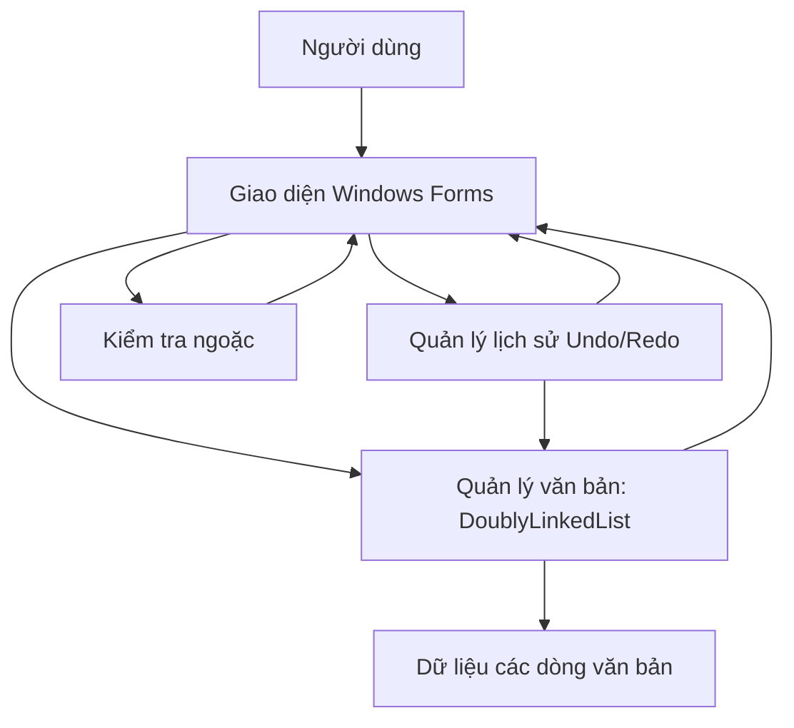

# CHƯƠNG 1. GIỚI THIỆU ĐỀ TÀI

## 1.1. Lý do lựa chọn đề tài

Trình soạn thảo văn bản là công cụ thường xuyên được sử dụng
trong học tập và lập trình. Trong quá trình chỉnh sửa, người dùng
có thể nhập sai, xóa nhầm hoặc thay đổi một đoạn nội dung.
Chức năng hoàn tác (Undo) và làm lại (Redo) giúp người dùng
khôi phục những thay đổi này.

Nhóm lựa chọn đề tài “Trình soạn thảo văn bản có Undo/Redo”
và đặt tên ứng dụng là CodeNote. Đề tài tạo điều kiện vận dụng
danh sách liên kết kép để quản lý các dòng văn bản, đồng thời
sử dụng ngăn xếp để quản lý lịch sử thao tác.

Đối với nội dung mã nguồn, kiểm tra tính cân bằng của các cặp
ngoặc là một tiện ích phù hợp. Chức năng này cũng là một
ứng dụng điển hình của cấu trúc ngăn xếp.

## 1.2. Mục tiêu

Các mục tiêu của dự án gồm:

- Quản lý các dòng văn bản bằng danh sách liên kết kép.
- Hỗ trợ chèn, xóa, tách dòng và gộp dòng.
- Hỗ trợ tìm kiếm và thay thế nội dung.
- Xây dựng cơ chế Undo/Redo bằng cấu trúc tự cài đặt.
- Giới hạn số bước hoàn tác được lưu trong lịch sử.
- Kiểm tra tính cân bằng của các cặp ngoặc (), [] và {}.
- Xây dựng giao diện Windows Forms bằng C++/CLI.
- Kiểm thử chức năng và đánh giá thời gian thực hiện.

Đây là các mục tiêu của đề tài. Mức độ hoàn thành từng mục
được xác định bằng mã nguồn và kết quả kiểm thử thực tế.

## 1.3. Phạm vi thực hiện

Ứng dụng tập trung vào soạn thảo văn bản và các đoạn mã nguồn.
Giao diện sử dụng Windows Forms C++/CLI, trong khi tầng lõi
quản lý văn bản được tổ chức riêng bằng C++.

Các cấu trúc dữ liệu chính được tự cài đặt bằng con trỏ.
Không sử dụng std::vector, std::list hoặc std::stack để thay
thế phần cấu trúc dữ liệu được yêu cầu. Chức năng Undo/Redo
cần được xây dựng riêng, không sử dụng Undo có sẵn của
Windows Forms thay cho thuật toán của nhóm.

Kiểm tra ngoặc chỉ xác định sự phù hợp của các cặp ngoặc
trong phạm vi mà chương trình hỗ trợ. Chức năng này không
thay thế trình biên dịch hoặc bộ kiểm tra toàn bộ cú pháp
của một ngôn ngữ lập trình.

## 1.4. Phương pháp thực hiện

Nhóm chia công việc thành các phần: thiết kế giao diện,
quản lý văn bản, quản lý lịch sử và kiểm thử.

Các thành phần được xây dựng độc lập trước khi tích hợp.
Phần kiểm thử chức năng sử dụng các ca có đầu vào, thao tác
và kết quả mong đợi rõ ràng.

Dữ liệu thực nghiệm gồm tệp mẫu 30 dòng và các tệp lớn
10.000, 20.000, 50.000 dòng. Thời gian xử lý được dự kiến
đo bằng std::chrono. Việc phân tích hiệu năng phải dựa trên
kết quả chạy thực tế trong điều kiện được ghi nhận.


# CHƯƠNG 2. CƠ SỞ LÝ THUYẾT

## 2.1. Danh sách liên kết kép

Danh sách liên kết kép gồm các nút được kết nối theo hai chiều.
Mỗi nút chứa dữ liệu, con trỏ đến nút trước và con trỏ đến
nút sau.

Trong CodeNote, một nút đại diện cho một dòng văn bản.
Cấu trúc Node trong mã nguồn gồm:

- lineData: nội dung dòng, sử dụng std::string.
- prev: con trỏ đến dòng trước.
- next: con trỏ đến dòng sau.

Lớp DoublyLinkedList quản lý head, tail và size, tương ứng
với nút đầu, nút cuối và số dòng hiện tại.

Ví dụ:

NULL ← [Dòng 1] ⇄ [Dòng 2] ⇄ [Dòng 3] → NULL

Danh sách cho phép duyệt theo cả hai chiều. Khi đã có
con trỏ tới vị trí cần xử lý, việc cập nhật các liên kết
để chèn hoặc xóa một nút có chi phí O(1).

Tuy nhiên, nếu đầu vào là chỉ số dòng, chương trình phải
tìm nút tương ứng. Trong mã nguồn của nhóm, getNodeAt
chọn duyệt từ head hoặc tail tùy vị trí. Cách này giảm
số nút cần duyệt nhưng độ phức tạp trường hợp xấu nhất
vẫn là O(n).

Ngoài chi phí liên kết, thao tác với nội dung dòng còn
có chi phí sao chép hoặc dịch chuyển ký tự trong chuỗi.
Vì vậy, không thể kết luận mọi thao tác chèn hoặc xóa
văn bản đều có độ phức tạp O(1).

## 2.2. Ngăn xếp

Ngăn xếp (Stack) hoạt động theo nguyên tắc LIFO:
phần tử được đưa vào sau cùng sẽ được lấy ra trước.

Các thao tác cơ bản:

- Push: đưa phần tử lên đỉnh.
- Pop: lấy phần tử ở đỉnh ra.
- Top: xem phần tử ở đỉnh.
- IsEmpty: kiểm tra ngăn xếp rỗng.

Với cách cài đặt bằng danh sách liên kết và quản lý
con trỏ đỉnh, Push và Pop có thể thực hiện trong O(1),
không tính chi phí sao chép dữ liệu của phần tử.

## 2.3. Nguyên lý Undo/Redo

Một cách tổ chức lịch sử là sử dụng hai ngăn xếp:
UndoStack và RedoStack.

Khi người dùng thực hiện thao tác mới:

1. Lưu thông tin cần thiết để hoàn tác thao tác.
2. Đưa bản ghi vào UndoStack.
3. Xóa lịch sử Redo cũ.

Khi thực hiện Undo:

1. Kiểm tra UndoStack có rỗng không.
2. Lấy thao tác gần nhất.
3. Thực hiện thao tác nghịch đảo.
4. Chuyển thông tin thao tác sang RedoStack.

Khi thực hiện Redo:

1. Kiểm tra RedoStack có rỗng không.
2. Lấy thao tác gần nhất đã hoàn tác.
3. Thực hiện lại thao tác.
4. Chuyển thông tin sang UndoStack.

Ví dụ, người dùng dán abc vào tài liệu trống bằng một
thao tác. Undo đưa tài liệu về trạng thái trống; Redo
đưa nội dung abc trở lại.

Thông tin trong bản ghi hành động phải đủ để phục hồi
văn bản, chẳng hạn loại hành động, vị trí và nội dung
đã chèn hoặc xóa.

Cách lưu bản ghi cụ thể sẽ được mô tả theo mã cài đặt
thực tế của thành viên phụ trách.

## 2.4. Giới hạn lịch sử hoàn tác

Giới hạn k bước nhằm kiểm soát số hành động được giữ lại.
Khi thêm hành động mới làm số bản ghi vượt quá k,
bản ghi cũ nhất cần được loại bỏ.

Một phương án là dùng danh sách liên kết kép để quản lý
hai đầu: một đầu phục vụ thao tác mới nhất, đầu còn lại
phục vụ loại bỏ thao tác cũ nhất.

Giới hạn số bản ghi không đồng nghĩa với giới hạn chính xác
số byte bộ nhớ, vì mỗi bản ghi có thể chứa lượng văn bản
khác nhau.

## 2.5. Kiểm tra ngoặc bằng ngăn xếp

Thuật toán cơ bản duyệt lần lượt các ký tự:

1. Gặp ngoặc mở thì đưa vào Stack.
2. Gặp ngoặc đóng thì kiểm tra Stack.
3. Nếu Stack rỗng hoặc đỉnh không cùng loại, kết luận sai.
4. Nếu cùng loại, lấy ngoặc mở khỏi Stack.
5. Kết thúc duyệt, chỉ chấp nhận nếu Stack rỗng.

Ví dụ:

- ([]{}) là cân bằng.
- ([)] không cân bằng vì sai thứ tự đóng ngoặc.
- (() không cân bằng vì thiếu ngoặc đóng.

Với N ký tự, thuật toán cơ bản có thời gian O(N)
và bộ nhớ phụ O(N) trong trường hợp xấu nhất.

Khi áp dụng cho mã nguồn, cần xác định rõ cách xử lý
ngoặc trong chuỗi ký tự và chú thích. Không mặc nhiên
coi thuật toán cơ bản là bộ phân tích cú pháp hoàn chỉnh.

## 2.6. Đo thời gian bằng std::chrono

std::chrono cung cấp các công cụ đo khoảng thời gian.
Có thể dùng steady_clock để lấy thời điểm trước và sau
một lời gọi hàm, sau đó tính hiệu hai thời điểm.

Để phép đo có ý nghĩa:

- Ghi rõ dữ liệu, môi trường và cờ biên dịch.
- Chạy nhiều lần và giữ lại kết quả từng lần.
- Chuẩn bị dữ liệu ngoài khoảng đo nếu không đo bước đó.
- Kiểm tra kết quả để bảo đảm hàm thực hiện đúng.
- Khôi phục dữ liệu đầu vào giữa các lần đo có thay đổi dữ liệu.
- Phân biệt thời gian thuật toán với thời gian giao diện.
- Ghi nhận ảnh hưởng của bộ nhớ đệm đối với đọc tệp.

Không suy ra độ phức tạp chỉ từ một lần chạy. Cần kết hợp
phân tích mã nguồn với xu hướng số liệu thực nghiệm.


# CHƯƠNG 3. PHÂN TÍCH VÀ THIẾT KẾ

## 3.1. Phân tích yêu cầu chức năng

Theo kế hoạch của nhóm, CodeNote hướng đến các chức năng sau:

| Nhóm chức năng | Yêu cầu |
|---|---|
| Quản lý tệp | Mở nội dung từ tệp và lưu nội dung ra tệp |
| Chỉnh sửa | Chèn, xóa ký tự; thêm, xóa, tách và gộp dòng |
| Tìm kiếm | Tìm lần xuất hiện đầu tiên, tiếp theo và tất cả vị trí |
| Thay thế | Thay nội dung tại vị trí cụ thể hoặc thay thế tất cả |
| Lịch sử | Hoàn tác, làm lại và giới hạn số thao tác được lưu |
| Kiểm tra ngoặc | Phát hiện ngoặc thiếu, thừa hoặc đóng sai thứ tự |
| Thống kê | Thống kê số dòng, số từ và số ký tự |
| Trực quan hóa | Minh họa cấu trúc danh sách và lịch sử thao tác |

Bảng trên mô tả yêu cầu thiết kế. Kết quả hoàn thành của từng
chức năng phải được xác nhận bằng quá trình tích hợp và kiểm thử.

## 3.2. Kiến trúc chương trình

Chương trình được định hướng tách thành tầng giao diện
và tầng lõi.

### 3.2.1. Tầng giao diện

Giao diện sử dụng Windows Forms C++/CLI, có nhiệm vụ:

- Hiển thị và tiếp nhận nội dung người dùng nhập.
- Nhận sự kiện từ menu, nút bấm và phím tắt.
- Chuyển yêu cầu xử lý xuống tầng lõi.
- Hiển thị kết quả và trạng thái thao tác.
- Vẽ phần trực quan hóa theo dữ liệu của tầng lõi.

### 3.2.2. Tầng lõi

Tầng lõi chịu trách nhiệm quản lý dữ liệu và thực hiện thuật toán.

Trong mã nguồn đã được xem xét, lớp DoublyLinkedList
được cài đặt bằng C++ thuần trong hai tệp:

- DoublyLinkedList.h
- DoublyLinkedList.cpp

Các thành phần lịch sử và kiểm tra ngoặc sẽ được mô tả
chi tiết sau khi đối chiếu mã nguồn của thành viên phụ trách.

Sơ đồ dưới đây thể hiện kiến trúc dự kiến, không dùng để
khẳng định mọi kết nối đã được tích hợp:



Việc tách tầng giúp kiểm thử các hàm quản lý văn bản
độc lập với giao diện. Điều này cũng hỗ trợ đo thời gian
xử lý mà không gộp thêm chi phí vẽ giao diện.

## 3.3. Thiết kế dữ liệu quản lý văn bản

### 3.3.1. Cấu trúc Node

Mỗi Node đại diện cho một dòng văn bản:

```cpp
struct Node {
    std::string lineData;
    Node* prev;
    Node* next;
};
```

Trong đó:

- lineData lưu nội dung của dòng.
- prev trỏ đến dòng trước, hoặc nullptr nếu là dòng đầu.
- next trỏ đến dòng sau, hoặc nullptr nếu là dòng cuối.

Ví dụ:

```text
head                                    tail
 ↓                                       ↓
[Dòng 1] ⇄ [Dòng 2] ⇄ [Dòng 3] ⇄ [Dòng 4]
```

### 3.3.2. Lớp DoublyLinkedList

Lớp quản lý ba thuộc tính chính:

| Thuộc tính | Vai trò |
|---|---|
| head | Trỏ đến nút đầu danh sách |
| tail | Trỏ đến nút cuối danh sách |
| size | Lưu số dòng hiện tại |

Các điều kiện cần duy trì:

- Khi danh sách rỗng, head và tail bằng nullptr, size bằng 0.
- Khi không rỗng, head->prev và tail->next bằng nullptr.
- Với hai nút liên tiếp, liên kết next và prev phải tương ứng.
- Số nút khi duyệt phải bằng size.

Lớp có hàm hủy, hàm tạo sao chép và toán tử gán sao chép.
Việc sao chép tạo các nút riêng để tránh hai danh sách
cùng sở hữu một vùng nhớ.

Đây là đặc điểm của thiết kế và mã cài đặt; việc xác nhận
không rò rỉ bộ nhớ vẫn cần kiểm tra thực tế.

### 3.3.3. Vị trí trong văn bản

Cấu trúc TextPosition lưu:

- line: chỉ số dòng.
- col: chỉ số cột.

Chỉ số bắt đầu từ 0. Ví dụ, vị trí dòng đầu và cột đầu
được biểu diễn bằng (0, 0).

Các hàm thao tác trên std::string sử dụng chỉ số phần tử
của chuỗi. Với dữ liệu UTF-8, chỉ số byte không nhất thiết
trùng với số ký tự người dùng nhìn thấy. Vì vậy, việc ánh xạ
vị trí giữa giao diện và tầng lõi cần được kiểm thử riêng
với văn bản tiếng Việt.

### 3.3.4. Kết quả tìm kiếm

Mỗi SearchResult lưu:

- line: dòng chứa kết quả.
- col: vị trí bắt đầu kết quả.
- length: độ dài đoạn khớp.
- next: kết quả tiếp theo.

Hàm findAll trả về danh sách liên kết đơn các kết quả.
Sau khi sử dụng, bên gọi cần giải phóng danh sách bằng
freeSearchResults để tránh giữ lại bộ nhớ đã cấp phát.

## 3.4. Thiết kế các nhóm thao tác

Các hàm được khai báo trong mã nguồn DoublyLinkedList gồm:

| Nhóm thao tác | Hàm tiêu biểu |
|---|---|
| Truy xuất | getSize, getNodeAt, getLine, setLine |
| Quản lý dòng | appendLine, prependLine, insertLine, deleteLine |
| Tách và gộp | splitLine, mergeLines |
| Chỉnh sửa ký tự | insertChar, deleteChar, backspaceChar |
| Chỉnh sửa đoạn | insertTextAt, deleteRange |
| Sao chép, cắt, dán | copyRange, cutRange, pasteText |
| Tìm kiếm | customStringFind, findFirst, findNext, findAll |
| Thay thế | replaceAt, replaceAll |
| Thống kê | getStatistics, getWordCount, getLineCount, getCharCount |
| Đọc và ghi | loadFromFile, saveToFile, loadFromText, getAllText |
| Trực quan hóa | getNodeVisualInfo |

Việc có hàm trong tầng lõi chưa đồng nghĩa nút hoặc menu
tương ứng trên giao diện đã kết nối và hoạt động đúng.

## 3.5. Thiết kế lịch sử thao tác

Theo kế hoạch, một bản ghi hành động cần chứa đủ thông tin
để thực hiện lại và đảo ngược thao tác.

Thông tin có thể gồm:

- Loại thao tác.
- Vị trí bắt đầu.
- Nội dung bị xóa.
- Nội dung được chèn.

UndoStack lưu các thao tác có thể hoàn tác.
RedoStack lưu các thao tác đã hoàn tác và có thể làm lại.

Trong lúc áp dụng Undo hoặc Redo, chương trình cần tránh
ghi chính thao tác phục hồi thành một thao tác chỉnh sửa mới.

Cấu trúc bản ghi, tên lớp và cách điều phối cụ thể cần
được cập nhật theo mã thực tế của TV3.

## 3.6. Thiết kế kiểm thử

Kiểm thử được chia thành hai nhóm:

### Kiểm thử chức năng

Dùng các trường hợp nhỏ với kết quả mong đợi rõ ràng:
chèn, xóa, xuống dòng, tìm kiếm, thay thế, Undo/Redo,
giới hạn lịch sử và kiểm tra ngoặc.

Danh sách ca kiểm thử được lưu tại:

TV4/KiemThu/KeHoachKiemThu.md

### Thực nghiệm hiệu năng

Dùng dữ liệu 10.000, 20.000 và 50.000 dòng để khảo sát
thời gian của các hàm xử lý.

Mỗi phép đo cần kiểm tra kết quả đầu ra, xác định phần công việc
được tính thời gian và giữ điều kiện chạy nhất quán.

Phần thực nghiệm chưa hoàn thành sẽ được ghi rõ ở Chương 5;
không dùng kết quả mong đợi thay cho số liệu thực tế.
